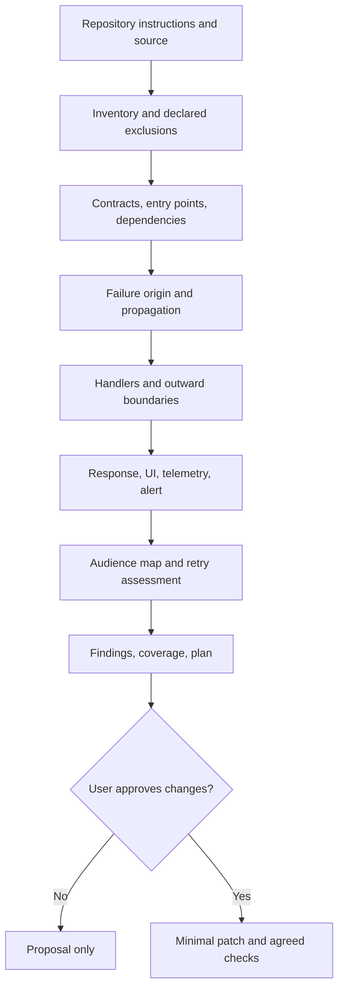

# Architecture and boundaries

## Product boundary

WhatsMyError is a **read-only coding-agent skill**. Its deliverable is an error map; it never modifies functions or application behavior. The canonical interface is `SKILL.md`, with `AGENTS.md` and product instruction shims for hosts that do not load the canonical format. The host agent reads the target repository and performs the audit. There is no scanner engine, CLI, service, or mandatory runtime dependency in this release.

## Intended analysis flow

## Evidence discipline

Findings should state observed evidence, inferred behavior, confidence, and missing context separately. Source locations support review; they are not proof of reachability or runtime impact. Contracts, project conventions, configuration, and tests can change a finding's interpretation. Unsupported language or framework areas remain explicit gaps.

## Planned implementation layers

These are design targets, not current features:

1. Discovery and coverage inventory.
2. Modular language/framework/protocol analyzers.
3. Error taxonomy and audience projection model.
4. Evidence and confidence aggregation.
5. Reviewable remediation planning and contract checks.
6. Report formats and integrations, only if future scope justifies executable tooling.

Any future scanner should remain optional and offline by default, avoid loading target code, and keep analysis independent from runtime libraries in the target application.
