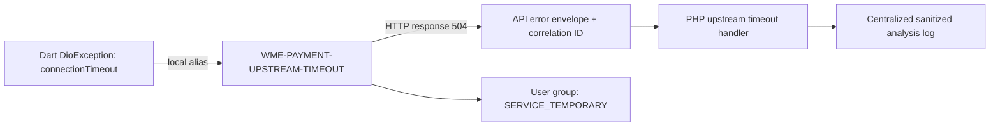

# Cross Files Error

**Cross Files Error** is the error-continuity model for tracing one failure across files, services, and languages, such as a Dart/Dio client → HTTP API → PHP application. It is a skill workflow and data format; this repository does not ship runtime middleware or modify application functions.

## Identity rules

1. Assign one stable canonical ID to the underlying failure, for example `WME-PAYMENT-UPSTREAM-TIMEOUT`.
2. Preserve that ID at every observed layer. Keep layer-specific codes and exception types as aliases mapped to the canonical ID; do not replace the canonical identity with a new unrelated ID at each hop.
3. Keep `correlation_id` consistent for one request when the existing system propagates it. Validate IDs at trust boundaries; report missing or broken propagation. Preserve `trace_id`/W3C `traceparent` only when observed and valid.
4. Link every mapping edge to source evidence and confidence. Similar labels alone do not prove two failures are the same event.
5. Preserve user-facing groups separately from technical identity. Several canonical errors may share a user message, while one canonical error can have different authorized role views.
6. Map every error to an observed, authorized technician/operator or admin handling path. If no technical/admin route can be established, mark a routing gap. Keep the user projection to a simple safe status/action and never expose the centralized diagnostic record to the user.

## Example path map



| Layer | Local signal/code | Canonical ID | Evidence to record |
|---|---|---|---|
| Dart client | `DioExceptionType.connectionTimeout` | `WME-PAYMENT-UPSTREAM-TIMEOUT` | Dio configuration, catch/mapping site, response parser |
| HTTP boundary | `504` and response `error.code` | Same canonical ID | API schema, status/body mapping, correlation header |
| PHP service | timeout exception or provider code | Same canonical ID | Exception handler, provider adapter, structured context |

Illustrative only: establish that each layer refers to the same underlying operation before connecting these records.

## Centralized timestamped analysis logs

When the user/task permits report artifacts, write sanitized JSON Lines or JSON records conforming to `schemas/error-log.schema.json` into the requested report destination. `logged_at` records when the skill produced the analysis entry, in ISO 8601 UTC (for example `2026-11-11T10:15:30Z`). Populate `event_time` only if the inspected application already records the actual event time; never present analysis time as event time. If writing is not allowed or no safe destination exists, return the records in the answer and say that no file was written.

```json
{
  "logged_at": "2026-11-11T10:15:30Z",
  "event_time": null,
  "error_id": "WME-PAYMENT-UPSTREAM-TIMEOUT",
  "category": "TIMEOUT",
  "severity": "ERROR",
  "outcome": "TRANSIENT_FAILURE",
  "service": "payments",
  "layer": "mobile_client",
  "operation": "create_payment",
  "source": {"path": "lib/payments/client.dart", "line": 42},
  "local_codes": [{"code": "DioExceptionType.connectionTimeout", "mapping_confidence": "medium", "evidence": "Mapped by the payment API timeout response."}],
  "correlation_id": "8a5d30cd-f46a-4e67-a3e4-6e54829ef01c",
  "trace_id": null,
  "http_status": 504,
  "user_group": "SERVICE_TEMPORARY",
  "audiences": ["USER", "SUPPORT", "TECHNICIAN"],
  "roles": ["customer", "operator"],
  "redaction": {"applied": true, "omitted_fields": ["request_body", "authorization_header", "stack_trace"]},
  "evidence": ["Dart timeout mapping", "API 504 error schema", "PHP timeout handler"],
  "confidence": "medium"
}
```

These records document what the skill found. They are not proof that runtime logging is already centralized. Adding runtime log statements or changing functions is outside this read-only skill; describe such work separately without applying it.

## User message and language-specific guidance

Every mapped user-visible outcome gets a short message in the application's locale. Confirm success only when evidence establishes completion (for example, “Inviato correttamente” / “Sent successfully”). For errors, prefer a safe next step or a neutral fallback; keep canonical IDs, local aliases, exception details, and log records in the technical/admin view. When the source has no suitable message, draft a proposed message in the analysis artifact. If asked how it would be integrated, provide an idiomatic Dart/PHP/etc. example separately; the skill does not patch functions or runtime code.
